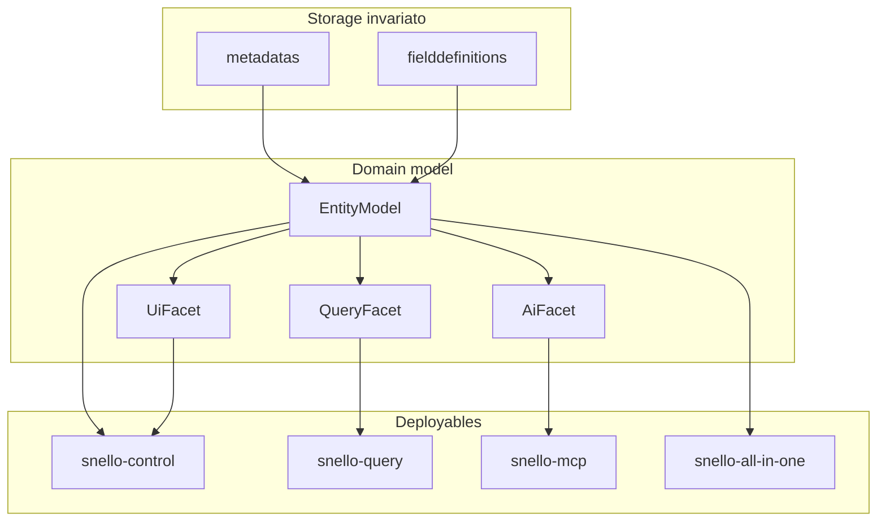
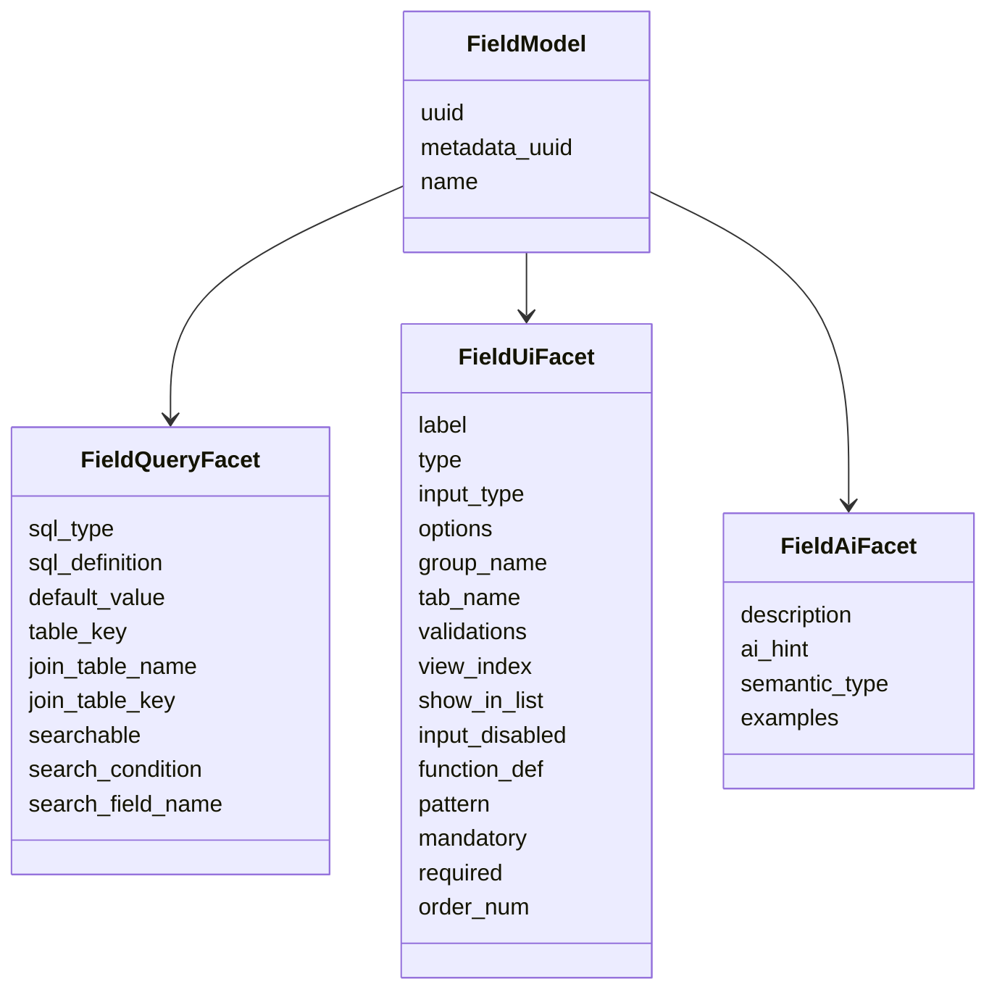
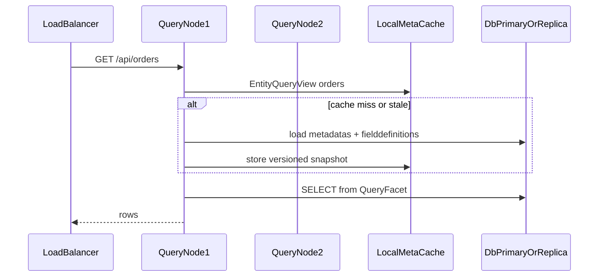

# Reingegnerizzazione Snello: facet + query plane

> **Stato:** proposta per discussione di team — non ancora un impegno di implementazione.
>
> Versione inglese: [ARCHITECTURE_REENGINEERING.md](ARCHITECTURE_REENGINEERING.md)

## Diagnosi (stato attuale)

Oggi [`Metadata`](src/main/java/io/snello/model/Metadata.java) e [`FieldDefinition`](src/main/java/io/snello/model/FieldDefinition.java) sono bag di proprietà pubbliche mappate 1:1 su `metadatas` / `fielddefinitions`. Il runtime le consuma in modo misto:

- **Query/DDL**: `table_name`, `table_key*`, `select_fields`, `order_by`, `alias_*`, `creation_query`, `type`/`input_type`/`sql_definition`/`join_*` via [`ApiService`](src/main/java/io/snello/service/ApiService.java) + `*JdbcRepository`
- **UI (SPA)**: `label`, `options`, `group_name`, `tab_*`, `icon`, `show_in_list`, … serviti da [`DataListServiceRs`](src/main/java/io/snello/service/rs/DataListServiceRs.java), quasi mai usati server-side
- **AI**: stack flower-style — skills + MCP tools + SQL `ai_tools` opzionali (`SnelloCmsTools` hardcoded rimosso)

Il monolitico Quarkus ha un solo deployable; la “cache” metadati è una `Map` in [`MetadataService`](src/main/java/io/snello/service/MetadataService.java) invalidata da eventi CDI.

## Principio guida

**Stesso storage, concern separati in Java (e nei contratti).** Le tabelle restano piatte; i model diventano composizione di facet. Ogni runtime carica solo le facet che gli servono.



## 1. Spezzatura model (fase fondante)

Introdurre package `io.snello.model.entity` (o `facet`) senza rompere subito i consumer esistenti.

### Entity (identità)

- `uuid`, `table_name` (nome logico / API resource)
- `metadata_group` (tassonomia)
- lifecycle: `already_exist`, `created`

### QueryFacet (Metadata)

| Campo | Ruolo |
|---|---|
| `table_key`, `table_key_type`, `table_key_addition` | PK / generation |
| `select_fields`, `order_by` | list default |
| `alias_table`, `alias_condition` | physical redirect |
| `creation_query` | DDL override |
| `api_protected`, `username_field` | row-level filter (query-time) |

### UiFacet (Metadata)

| Campo | Ruolo |
|---|---|
| `icon`, `tab_groups` | shell UI |
| `calendar_*` | vista calendario |
| `search_fields` | hint UI (oggi inutilizzato server-side) |

### AiFacet (Metadata) — nuovo concern esplicito

Oggi quasi assente; va progettato per authoring AI:

- `description` (già c’è) → elevare a testo obbligatorio per tools
- `ai_summary` / `ai_synonyms` (nuove colonne *solo se necessarie*; altrimenti JSON in colonna `ai_meta` — preferenza: **una colonna JSON `ai_profile`** per non proliferare ALTER)
- `tool_visibility` (esporre in MCP/`listEntities` o no)
- `examples` (payload esempio per create/update)

### FieldDefinition → tre facet



**Regola di mapping:** `fromMap`/`toMap` restano sul root `FieldModel` / `EntityModel` (compatibilità tabelle), ma i servizi tipizzano contro le facet.

**Pulizia immediata inclusa:** bug in `FieldDefinition.fromMap` (`validations` → `metadata_name`; instanceof sbagliati su `view_index`/`mandatory`/`order_num`); `search_fields` mancante in `Metadata.toMap()`.

**Enum tipizzati** (sostituiscono stringhe dove possibile, serializzati come stringa DB): `WidgetType`, `InputType`, `KeyType`, `SearchOp` — senza migration se i valori restano gli stessi letterali.

Backward compat: tenere `Metadata` / `FieldDefinition` come **facade deprecata** che delega alle facet per 1–2 cicli, così `ApiService` e RS non si riscrivono in un colpo solo.

## 2. Contratti AI-first (authoring metadati)

Assunzione: **l’AI diventa il writer principale** di metadati; l’UI admin diventa editor assistito.

- Definire JSON Schema (o record Java + OpenAPI) per:
  - `EntityDraft` = QueryFacet + AiFacet (+ UiFacet opzionale)
  - `FieldDraft` = name + QueryFacet minimo + AiFacet + UiFacet default derivabile
- API draft (`DraftService` / `/api/drafts`) accettano/emettono **draft tipizzati**, non `Map` grezze
- Derivazioni automatiche (riducono carico sull’AI):
  - da `semantic_type` / `sql_type` → default `type`/`input_type` UI
  - da `show_in_list`/`searchable` → ricomposizione `select_fields` / search hints
  - validazione: nome colonna, reserved words ([`MetadataUtils`](src/main/java/io/snello/util/MetadataUtils.java)), join coerenti
- Layer MCP (nuovo modulo/runtime): tools read (`list_entities`, `describe_entity`, `query_rows`) e write (`propose_entity`, `apply_entity`) con dry-run DDL

Output target per AI: profilo “query + AI” obbligatorio; UI auto-suggerita e override umano/AI opzionale.

## 3. Separazione runtime: control vs query

**Default scelto:** Maven multi-module sotto [`snello-parent`](pom.xml):

```text
snello-parent
  snello-core           # dominio / JDBC / services condivisi (jandex)
  snello-control-app    → image snello-control
  snello-query-app      → image snello-query
  snello-mcp-app        → image snello-mcp
  snello-all-in-one-app → image snello-all-in-one
```

Le app DB-facing partono come Quarkus **mutable-jar** e specializzano il driver JDBC con **re-augmentation** stile Keycloak (`snello-optimize.sh` / `quarkus.launch.rebuild`, via `SNELLO_DB_KIND`). Le build native (control) fissano `db-kind` a compile-time.

| Immagine | Capacità | Dipendenze facet |
|---|---|---|
| `snello-control` | CRUD metadati, DDL, admin RS, AI write tools | Query + UI + AI |
| `snello-query` | solo `GET/POST list/fetch` su `/api/{table}` (+ count); **no** create metadata, **no** DDL, **no** truncate | solo QueryFacet (+ security row filter) |
| `snello-mcp` | MCP server + schema tools; può puntare a query plane | AiFacet + QueryFacet |
| `snello-all-in-one` | API full control + **H2** + FS docs; **senza SPA**; **OIDC esterno**; singolo container per demo / local / eval | Query + UI + AI |

Meccanismo tecnico Quarkus:

- `@IfBuildProfile("query")` / `@UnlessBuildProfile("query")` su RS e CDI beans
- oppure exclusion di package in `quarkus.arc.exclude-types` / index filtering per profilo
- Dockerfile sotto ogni modulo app (`*/src/main/docker/Dockerfile.jvm`, native sotto control)

### Immagine all-in-one (H2, senza SPA — **fatto**)

Obiettivo: un container che avvia Snello usabile senza DB esterno — per demo, onboarding, smoke CI ed esperimenti di authoring AI. **v1 senza SPA embedded**; SSO sempre esterno.

```mermaid
flowchart LR
  subgraph aio [snello-all-in-one container]
    API[Quarkus full API]
    H2[(H2 file /data)]
    FS[/data/files]
    API --> H2
    API --> FS
  end
  SSO[OIDC / Keycloak esterno] -->|validazione token| API
```

Scelte fissate per questa immagine:

- **DB:** H2 (`snello.dbtype=h2`), schema bootstrap all’avvio; JDBC default **file** `/data/snello` (volume); override `SNELLO_JDBC_URL` per `jdbc:h2:mem:…`
- **Frontend:** **non** nell’immagine (solo API). Opzionale in seguito: `dist/` Angular sibling in `META-INF/resources`
- **SSO:** OIDC esterno (`QUARKUS_OIDC_AUTH_SERVER_URL`, …); bootstrap admin Keycloak opzionale via `SNELLO_KEYCLOAK_ADMIN_*`
- **Storage:** filesystem (`snello.storagetype=fs`, `/data/files`) — MinIO non richiesto
- **Superficie API:** full control plane, non query-only
- **Non è target HA di produzione:** la produzione resta control + query replicas + MySQL/PostgreSQL esterno; all-in-one è il canale di comodità (`compose-allinone.yml`)

### Nodi query + cache + replica



Design cache (sostituisce le Map package-private attuali):

- Snapshot versionato: `meta_version` (timestamp o hash da riga di controllo / `MAX(updated_at)` se aggiungi colonna, altrimenti checksum su uuid+campi query)
- Ogni nodo query: refresh periodico + invalidazione su webhook/event bus opzionale da control plane
- Nessuna scrittura metadati sul query plane → coerenza semplice
- JDBC: datasource **read-only** verso replica DB quando disponibile; fallback primary in read-only mode a livello app (`SET SESSION TRANSACTION READ ONLY` / flag Quarkus)

Out of scope iniziale: shard per tenant; focus = N repliche stateless dietro LB.

## 4. Refactor servizi (allineato alle facet)

Ordine interno, dopo i model:

1. Estrarre `EntityQueryView` / `FieldQueryView` (proiezioni immutabili) usate da `ApiService.list/fetch`
2. Muovere costruzione SQL verso un unico `SqlQueryBuilder` (oggi triplicato in mysql/postgresql/h2)
3. `MetadataService` → `EntityCatalog` con API: `queryView(name)`, `uiView(name)`, `aiView(name)`
4. RS admin restano su control; `ApiServiceRs` mutazioni dati restano su control (o profilo `full`); query image espone solo list/fetch/count

## 5. Roadmap incrementalmente shippable

1. **Facet + facade** — **fatto** (datalist facet + `EntityCatalog` query/ui/ai)
2. **AiFacet JSON + draft schema + tool rewrite** — **fatto**
3. **Build profile `query` + Dockerfile + compose multi-replica** — **fatto** (+ JDBC read-only sul query plane)
4. **Immagine all-in-one** — **fatto** (H2 + FS + SSO esterno; senza SPA — `snello-all-in-one-app` / `compose-allinone.yml`)
5. **Immagine MCP** — shell presente; protocollo TBD
6. **SqlQueryBuilder unificato** — **fatto** (`SqlQueryBuilder` + facade dialetti)

## Decisioni fissate in questa proposta

- Tabelle DB **non** spezzate; eventuale solo colonna JSON `ai_profile` (e analoga su field) quando serve
- Un repo Maven (`snello-parent`), **app multi-modulo** → immagini `snello-control` / `snello-query` / `snello-mcp`
- Selezione driver DB via **mutable-jar re-augmentation** Quarkus (stile Keycloak), non tre datasource nominati a runtime
- Query nodes: DB condiviso/replica + cache metadati locale versionata
- UI facet resta first-class per la SPA, ma **derivabile** da AI/query per ridurre lavoro di authoring
- Compatibilità: facade `Metadata`/`FieldDefinition` durante la migrazione dei consumer
- **Immagine Docker all-in-one** con API full + **H2** + FS + **OIDC esterno**; SPA opzionale in seguito (repo Angular sibling); per demo/local/eval, non come topologia HA di produzione
- Angular resta un **repository sibling** se/quando embedded; coupling solo a build-time, non un Maven submodule dentro `snello-api`

## Aperti alla discussione

- Ordine di priorità degli step di roadmap
- Se MCP serve come immagine separata in v1, o bastano i tool LangChain4j all’inizio
- Naming delle immagini Docker / profili Quarkus
- Se/quando aggiungere la SPA Angular dentro all-in-one (oggi API-only)
