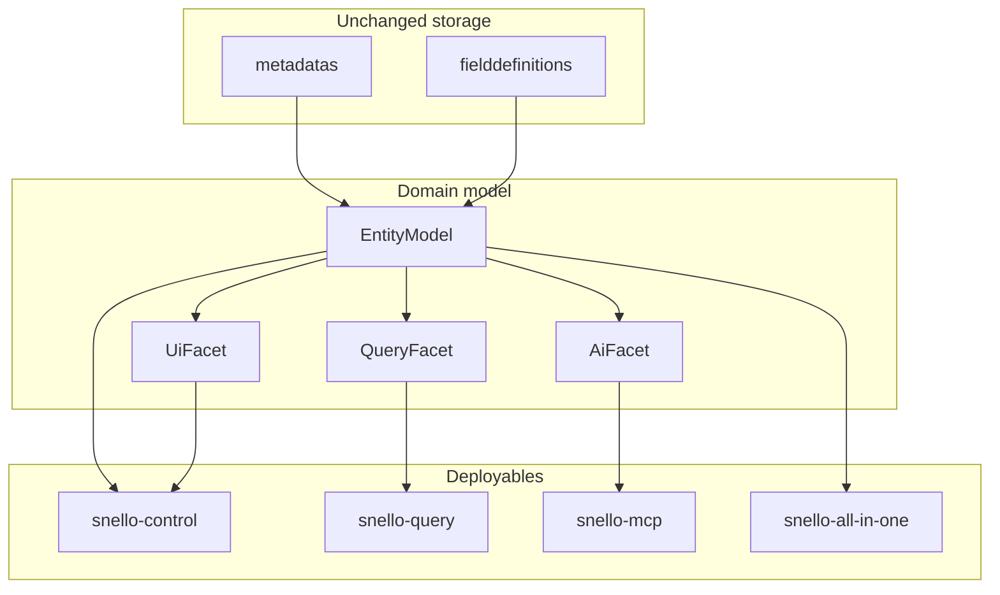
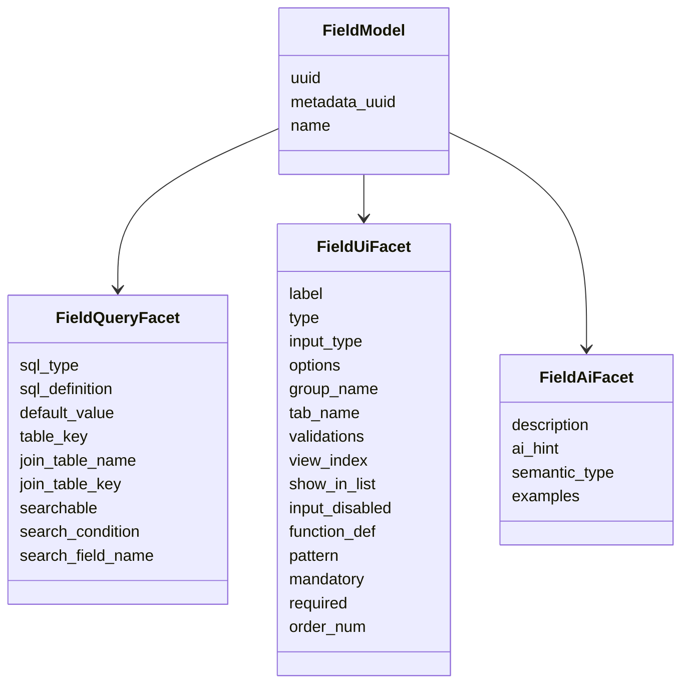
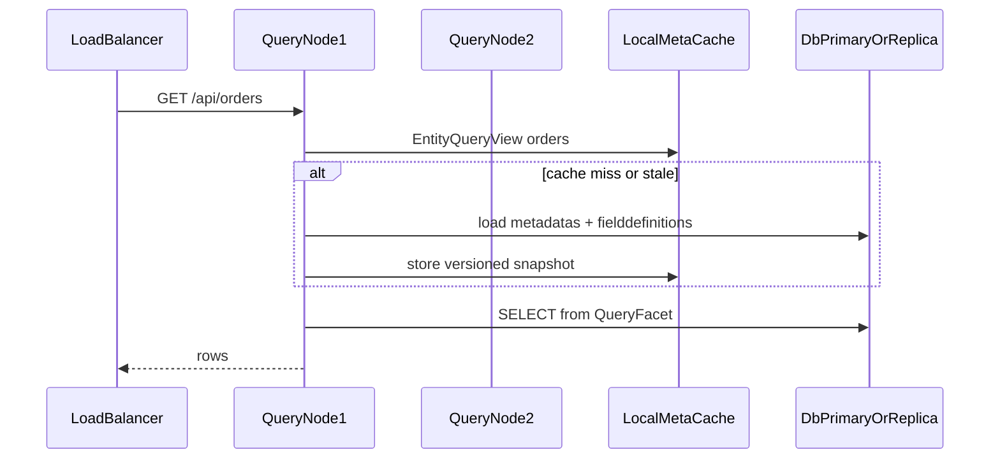

# Snello reengineering: facets + query plane

> **Status:** proposal for team discussion — not an implementation commitment yet.
>
> Italian version: [ARCHITECTURE_REENGINEERING.it.md](ARCHITECTURE_REENGINEERING.it.md)

## Diagnosis (current state)

Today [`Metadata`](src/main/java/io/snello/model/Metadata.java) and [`FieldDefinition`](src/main/java/io/snello/model/FieldDefinition.java) are bags of public fields mapped 1:1 onto `metadatas` / `fielddefinitions`. The runtime consumes them in a mixed way:

- **Query/DDL**: `table_name`, `table_key*`, `select_fields`, `order_by`, `alias_*`, `creation_query`, `type`/`input_type`/`sql_definition`/`join_*` via [`ApiService`](src/main/java/io/snello/service/ApiService.java) + `*JdbcRepository`
- **UI (SPA)**: `label`, `options`, `group_name`, `tab_*`, `icon`, `show_in_list`, … served by [`DataListServiceRs`](src/main/java/io/snello/service/rs/DataListServiceRs.java), almost never used server-side
- **AI**: flower-style stack — skills + MCP tools + optional SQL `ai_tools` (hardcoded `SnelloCmsTools` removed)

The Quarkus monolith has a single deployable; the metadata “cache” is a `Map` in [`MetadataService`](src/main/java/io/snello/service/MetadataService.java) invalidated by CDI events.

## Guiding principle

**Same storage, concerns separated in Java (and in contracts).** Tables stay flat; models become facet composition. Each runtime loads only the facets it needs.



## 1. Model split (foundational phase)

Introduce package `io.snello.model.entity` (or `facet`) without immediately breaking existing consumers.

### Entity (identity)

- `uuid`, `table_name` (logical name / API resource)
- `metadata_group` (taxonomy)
- lifecycle: `already_exist`, `created`

### QueryFacet (Metadata)

| Field | Role |
|---|---|
| `table_key`, `table_key_type`, `table_key_addition` | PK / generation |
| `select_fields`, `order_by` | list defaults |
| `alias_table`, `alias_condition` | physical redirect |
| `creation_query` | DDL override |
| `api_protected`, `username_field` | row-level filter (query-time) |

### UiFacet (Metadata)

| Field | Role |
|---|---|
| `icon`, `tab_groups` | UI shell |
| `calendar_*` | calendar view |
| `search_fields` | UI hint (unused server-side today) |

### AiFacet (Metadata) — new explicit concern

Almost absent today; must be designed for AI authoring:

- `description` (already exists) → elevate to required text for tools
- `ai_summary` / `ai_synonyms` (new columns *only if needed*; otherwise JSON in an `ai_meta` column — preference: **one JSON column `ai_profile`** to avoid ALTER proliferation)
- `tool_visibility` (expose in MCP/`listEntities` or not)
- `examples` (sample payloads for create/update)

### FieldDefinition → three facets



**Mapping rule:** `fromMap`/`toMap` stay on the root `FieldModel` / `EntityModel` (table compatibility), but services type against the facets.

**Immediate cleanup included:** bugs in `FieldDefinition.fromMap` (`validations` written into `metadata_name`; wrong instanceof checks on `view_index`/`mandatory`/`order_num`); `search_fields` missing from `Metadata.toMap()`.

**Typed enums** (replace strings where possible, serialized as DB strings): `WidgetType`, `InputType`, `KeyType`, `SearchOp` — no migration if literal values stay the same.

Backward compatibility: keep `Metadata` / `FieldDefinition` as a **deprecated facade** that delegates to facets for 1–2 cycles, so `ApiService` and RS resources are not rewritten in one shot.

## 2. AI-first contracts (metadata authoring)

Assumption: **AI becomes the primary writer** of metadata; the admin UI becomes an assisted editor.

- Define JSON Schema (or Java records + OpenAPI) for:
  - `EntityDraft` = QueryFacet + AiFacet (+ optional UiFacet)
  - `FieldDraft` = name + minimal QueryFacet + AiFacet + derivable default UiFacet
- Draft APIs (`DraftService` / `/api/drafts`) accept/emit **typed drafts**, not raw `Map`s
- Automatic derivations (reduce AI load):
  - from `semantic_type` / `sql_type` → default UI `type`/`input_type`
  - from `show_in_list`/`searchable` → recompose `select_fields` / search hints
  - validation: column name, reserved words ([`MetadataUtils`](src/main/java/io/snello/util/MetadataUtils.java)), coherent joins
- MCP layer (new module/runtime): read tools (`list_entities`, `describe_entity`, `query_rows`) and write tools (`propose_entity`, `apply_entity`) with DDL dry-run

AI target output: mandatory “query + AI” profile; UI auto-suggested with optional human/AI override.

## 3. Runtime split: control vs query

**Chosen default:** Maven multi-module under [`snello-parent`](pom.xml):

```text
snello-parent
  snello-core           # shared domain / JDBC / services (jandex)
  snello-control-app    → image snello-control
  snello-query-app      → image snello-query
  snello-mcp-app        → image snello-mcp
  snello-all-in-one-app → image snello-all-in-one
```

DB-facing apps ship as Quarkus **mutable-jar** and specialize the JDBC driver with Keycloak-style **re-augmentation** (`snello-optimize.sh` / `quarkus.launch.rebuild`, driven by `SNELLO_DB_KIND`). Native builds (control) fix `db-kind` at compile time instead.

| Image | Capabilities | Facet dependencies |
|---|---|---|
| `snello-control` | metadata CRUD, DDL, admin RS, AI write tools | Query + UI + AI |
| `snello-query` | only `GET/POST list/fetch` on `/api/{table}` (+ count); **no** metadata create, **no** DDL, **no** truncate | QueryFacet only (+ security row filter) |
| `snello-mcp` | MCP server + schema tools; may point at the query plane | AiFacet + QueryFacet |
| `snello-all-in-one` | full control API + **H2** + FS docs; **no SPA**; **external OIDC**; single container for demos / local / eval | Query + UI + AI |

Quarkus mechanism:

- `@IfBuildProfile("query")` / `@UnlessBuildProfile("query")` on RS and CDI beans
- or package exclusion via `quarkus.arc.exclude-types` / index filtering per profile
- Dockerfiles under each app module (`*/src/main/docker/Dockerfile.jvm`, native under control)

### All-in-one image (H2, no SPA — **done**)

Goal: one container that boots usable Snello with zero external DB — for demos, onboarding, CI smoke, and AI-authoring experiments. **v1 ships without an embedded SPA**; SSO is always external.

```mermaid
flowchart LR
  subgraph aio [snello-all-in-one container]
    API[Quarkus full API]
    H2[(H2 file /data)]
    FS[/data/files]
    API --> H2
    API --> FS
  end
  SSO[External OIDC / Keycloak] -->|token validation| API
```

Locked choices for this image:

- **DB:** H2 (`snello.dbtype=h2`), schema bootstrapped on startup; default JDBC URL is **file** `/data/snello` (volume); override `SNELLO_JDBC_URL` for `jdbc:h2:mem:…` if desired
- **Frontend:** **not** in the image (API-only). Optional later: sibling Angular `dist/` into `META-INF/resources`
- **SSO:** external OIDC (`QUARKUS_OIDC_AUTH_SERVER_URL`, …); optional Keycloak admin bootstrap via `SNELLO_KEYCLOAK_ADMIN_*`
- **Storage:** filesystem (`snello.storagetype=fs`, `/data/files`) — no MinIO required
- **API surface:** full control plane, not query-only
- **Not a production HA target:** production stays control + query replicas + external MySQL/PostgreSQL; all-in-one is the convenience/distribution channel (`compose-allinone.yml`)

### Query nodes + cache + replica



Cache design (replaces today’s package-private Maps):

- Versioned snapshot: `meta_version` (timestamp or hash from a control row / `MAX(updated_at)` if a column is added, otherwise checksum over uuid + query fields)
- Each query node: periodic refresh + optional invalidation via webhook/event bus from the control plane
- No metadata writes on the query plane → simple consistency
- JDBC: **read-only** datasource against a DB replica when available; fallback to primary in app-level read-only mode (`SET SESSION TRANSACTION READ ONLY` / Quarkus flag)

Initial out of scope: per-tenant sharding; focus = N stateless replicas behind a load balancer.

## 4. Service refactor (aligned with facets)

Internal order, after the models:

1. Extract `EntityQueryView` / `FieldQueryView` (immutable projections) used by `ApiService.list/fetch`
2. Move SQL construction into a single `SqlQueryBuilder` (today triplicated in mysql/postgresql/h2)
3. `MetadataService` → `EntityCatalog` with API: `queryView(name)`, `uiView(name)`, `aiView(name)`
4. Admin RS stay on control; `ApiServiceRs` data mutations stay on control (or `full` profile); query image exposes only list/fetch/count

## 5. Incrementally shippable roadmap

1. **Facets + facade** (no new columns; fix fromMap; enums; catalog views) — **done** (datalist facet APIs + `EntityCatalog` query/ui/ai)
2. **AiFacet JSON + draft schema + tool rewrite** — **done** (`ai_profile`, drafts, tools)
3. **Build profile `query` + Dockerfile + multi-replica compose** — **done** (control/query apps + read-only JDBC interceptor on query)
4. **All-in-one image** — **done** (H2 + FS + external SSO; no SPA yet — `snello-all-in-one-app` / `compose-allinone.yml`)
5. **MCP image** (if an external protocol beyond current LangChain4j is needed) — shell module exists; protocol TBD
6. **Unified SqlQueryBuilder** + identifier-quoting hardening — **done** (`SqlQueryBuilder` + thin dialect facades; MySQL backticks)

Follow-ups still open: optional SPA layer in all-in-one; SPA consumes facet datalist; optional PG double-quote identifiers; JDBC replica URL for query; full MCP tools.

## Decisions locked in this proposal

- DB tables are **not** split; at most a JSON `ai_profile` column (and a field equivalent) when needed
- One Maven repo (`snello-parent`), **multi-module apps** → `snello-control` / `snello-query` / `snello-mcp` images
- DB driver selection via Quarkus **mutable-jar re-augmentation** (Keycloak-style), not three named datasources at runtime
- Query nodes: shared DB / replica + versioned local metadata cache
- UI facet stays first-class for the SPA, but is **derivable** from AI/query to reduce authoring work
- Compatibility: `Metadata`/`FieldDefinition` facade while consumers migrate
- **All-in-one Docker image** ships full API + **H2** + FS docs + **external OIDC**; SPA optional later (sibling Angular repo); used for demos/local/eval, not as the HA production topology
- Angular remains a **sibling repository** if/when embedded; coupling is build-time only, not a Maven submodule inside `snello-api`

## Open for discussion

- Priority order of roadmap steps
- Whether MCP is needed as a separate image in v1, or LangChain4j tools are enough initially
- Naming of Docker images / Quarkus profiles
- Whether all-in-one should support optional file-based H2 persistence via volume
