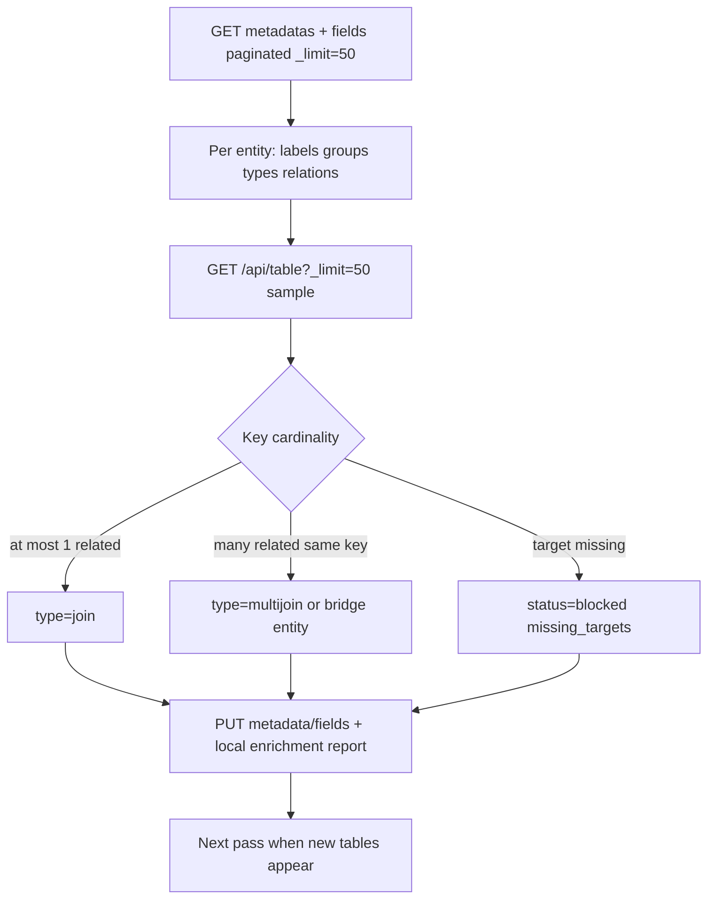

# AI metadata enrichment (multi-pass)

Post-introspect enrichment of **labels**, **`metadata_group`**, widget **types**, and **relations** on a live Snello catalog (reference target: `https://mssql.sne.lol`).

This is an **API / agent** workflow, not a change to JDBC introspect heuristics. Use it after `/api/introspect` (or batch import) when field labels are still glued, groups are null, and many `*_id` columns remain scalar `input`.

## Scale assumptions (200+ tables)

Catalogs are **large and still growing**:

| Signal | Guidance |
|--------|----------|
| Metadata count | **200+** entities (and climbing as introspect continues). Never assume a single unpaged `GET /api/metadatas` is complete. |
| Fielddefinitions | Thousands of rows; always page. |
| Default page size | Prefer **`_limit=50`** for metadatas, fields, and row samples (avoids API/pod pressure). |
| Full list | `GET /api/metadatas?_limit=50&_start=0` then advance `_start` until empty (or use `x-total-count` / size headers when present). Same for `/api/fielddefinitions`. |
| Row samples | `GET /api/{table_name}?_limit=50` (public reads). Do **not** use `/api/datalist/{table}` for samples (404). |

Treat enrichment as **idempotent multi-pass** work: each pass may leave relations `blocked` until missing target tables are introspected.

## Verified context

- Write auth: Admin Bearer from `.env.test` → `client_credentials` on `accounts.kayak.love` / realm `alphasnello` (same pattern as `dev/scripts/import-ai-catalog.sh`).
- Metadatas have **no** `label` column: human title → `description` + `ai_profile.summary` / `synonyms`; SPA menu → `metadata_group`.
- After raw introspect: many JDBC `join`s may already exist; leftovers are glued `input`, unresolved `*_id`, null `metadata_group`, compound Italian names.

## Principle: repeatable and incomplete-by-design

The catalog is not closed. A relation may stay unresolved until the target metadata exists (or until row data is sufficient). Every pass must be idempotent and record what is still missing.



### Multi-pass status

Remote `EntityAiProfile` only persists `summary` / `synonyms` / `tool_visible` / `examples` and **strips** unknown keys on write. Therefore:

| Where | What |
|-------|------|
| Local report | `complete` / `partial` / `blocked` + `missing_targets` → e.g. `dev/exports/enrichment-pass1.json` (source of truth between passes) |
| Metadata row | Human `description` + `ai_profile.summary` / `synonyms`; short incompleteness notes only in `summary` if useful |
| Follow-up (optional) | Extend `EntityAiProfile` with an `enrichment` object for server-side persistence |

Meanings:

- **`complete`**: labels + group OK; relations resolved or deliberately scalar.
- **`partial`**: labels/group OK; some relations/types still uncertain.
- **`blocked`**: missing metadata (or data) — **do not invent** joins.
- **Pass N+1**: reprocess only `partial` / `blocked` (and newly introspected tables); reuse existing `metadata_group` values.

## Enrichment rules

### Labels and description

- Split glued Italian compounds (`codicefiscale` → `Codice fiscale`); ignore noisy prefixes such as `a_` / `aa_` / `aaa_` in titles.
- Entity: set `description` + `ai_profile.summary` / `synonyms` (no metadata `label` column).

### `metadata_group` (menu taxonomy)

- Short, **reused** Italian (or domain) strings across the catalog (e.g. Operatori, Anagrafiche, Automezzi, Acquisti).
- Build the vocabulary from **all** `table_name` values (200+), plus any groups already set — not one slug per table; avoid a generic catch-all like `data` unless it is intentional for leftovers.

### Join vs multijoin (data-aware)

For each relation candidate (`*id` / `*_id` / `*_uuid`, existing join, suspected bridge):

1. If the **target is not** among current `table_name`s → `blocked` + `missing_targets`; keep scalar/`input` (or keep an existing correct join).
2. If the target exists → sample `GET /api/{owner_or_bridge}?_limit=50` (increase only if needed) and count related rows per key:
   - **At most one** related on the “one” side → `join` (+ `join_table_name` / key / `join_table_select_fields`).
   - **Many rows with the same key** → prefer `multijoin` on the owner **only** when the Snello model allows it; otherwise keep a **bridge entity** with two `join`s (as introspect often does) and note that in the local report. Do not destructively convert an introspected bridge without clear evidence.
3. Do not regress JDBC/value-confirmed joins without contradictory data.

### Widget / semantic types

- Only existing enums (`WidgetType` / `SemanticType`).
- Promote date/datetime/select when names or samples are clear.
- **No DDL** changes in this flow.

## Remote checklist

Already available:

- Base URL (e.g. `https://mssql.sne.lol`)
- Public reads: metadatas/fields (paged), row data `/api/{table}`
- Admin writes via `.env.test` + Keycloak token

Confirm before bulk writes:

1. OK to **PUT** across the **full catalog** (200+ metadatas and their fields) on that instance.
2. OK to track multi-pass state in the **local report** (until `ai_profile.enrichment` exists server-side).

Defaults if unspecified: `_limit=50`; Italian reusable `metadata_group` vocabulary.

## Phase 1 — Pass 1 (script / API)

Helper: [`dev/scripts/enrich-metadata-pass1.py`](../dev/scripts/enrich-metadata-pass1.py)

```bash
# from repo root, with .env.test loaded or CLIENT_ID/SECRET set
SNELLO_URL=https://mssql.sne.lol ./dev/scripts/enrich-metadata-pass1.py
```

Useful env knobs for large catalogs: `ENRICH_SLEEP`, `ENRICH_META_STALE_ONLY`, `ENRICH_RELATIONS_ONLY`, `ENRICH_TABLES`, `ENRICH_MAX_TABLES`, `ENRICH_DRY_RUN=1`.

Steps:

1. Mint/refresh token; load **all** metadatas + fields with `_limit=50` pagination.
2. Propose `metadata_group` taxonomy over the whole catalog (200+ names).
3. Per entity: labels/description; data-aware relations; record status in the local report.
4. PUT with pacing; summarize `complete` / `partial` / `blocked` and frequent `missing_targets`.
5. Spot-check before/after on a few known entities (including ones that already have joins).

## Phase 2 — Skill + MCP (repeatable from chat)

Project `snello.cms`:

- Skill **`enrich_metadata_catalog`**: multi-pass rules, groups, labels, join/multijoin, never invent targets; always page with `_limit=50`.
- MCP tools (authenticated where needed): `list_metadatas`, `list_fields`, `get_entity_ai`, `sample_table_rows` → `GET /api/{table}?_limit=`, `update_metadata`, `update_field`.

See [AI Agent](ai-agent.md#metadata-enrich-skill-post-introspect).

## Phase 3 — Related docs

- [Schema introspect](introspect.md) — list paging; label/group gaps; pointer to this flow.
- [AI Agent](ai-agent.md) — skill / MCP.
- [Metadata](metadata.md) — role of `metadata_group` as menu taxonomy.

## Out of scope

- New `metadatas.label` column or an LLM job inside `IntrospectService`.
- Changing pure heuristics in `SchemaIntrospection` (this flow is post-introspect via API/agent).
- Mass remodel of `tab_groups` / field `group_name` unless a pass shows it is required.

## Success criteria (pass 1 on a 200+ catalog)

- Full metadata list loaded via pagination; `metadata_group` filled with a **small reused** set of groups.
- Sample labels readable; **no** join pointing at a missing `table_name`.
- Local enrichment report usable for pass 2 (`partial` / `blocked` + `missing_targets`).
- Skill + MCP available to re-run when introspect adds more tables.
